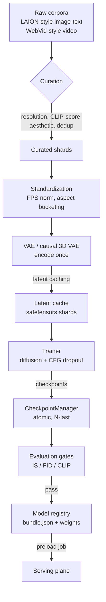

# Data Flow

> Status: current · Last audited: 2026-10-18 · Companion: [system-architecture.md](system-architecture.md)

## Training-plane data flow



Two properties matter at scale:

1. **Latents are cached once, reused every epoch.** For T2V especially,
   re-encoding video through the compression network every step would
   burn >40% of the training budget on a frozen component. The cache is
   sharded, checksummed, and validated at load (`data/latent_cache.py`).
2. **Nothing enters the registry without the eval gate.** The release
   workflow's FID/IS/CLIP thresholds (`configs/eval/default.yaml`) are
   the promotion contract — a regression cannot reach serving as a
   "training tweak".

## Serving-plane data flow

See the request lifecycle in
[system-architecture.md §3](system-architecture.md#3-request-lifecycle-the-only-path-that-matters).

Media bytes flow exactly once through the system: worker → artifact store
→ CDN → client. The API only ever mints pointers (presigned URLs), so
media traffic never scales API capacity.

## Job state transitions (authoritative)

```
QUEUED ──▶ RUNNING ──▶ SUCCEEDED
   │           │            (terminal)
   │           └──▶ FAILED ──▶ retry ≤ 2 ──▶ QUEUED
   └────────────────▶ CANCELLED        (terminal)
```

Every transition is validated in code (`serving/jobs.py`) and journaled
to `mm:job:{id}:events` with a timestamp — the audit trail alerting and
support tooling read.

## Data ownership

| Data | Owner | Lifetime | Backup story |
|---|---|---|---|
| Job hashes + queue | Redis | TTL 24h | reconstructible (artifacts + events) |
| Generated media | S3 bucket | indefinite | versioning + cross-region replication |
| Checkpoints | object store | N-last per experiment | registry manifest checksums |
| Latent caches | training bucket | per dataset version | reproducible from curated shards |
| Metrics | Prometheus | 30d raw / 1y downsampled | remote-write to long-term store |
| Logs | aggregator | 30d | S3 archive export |
