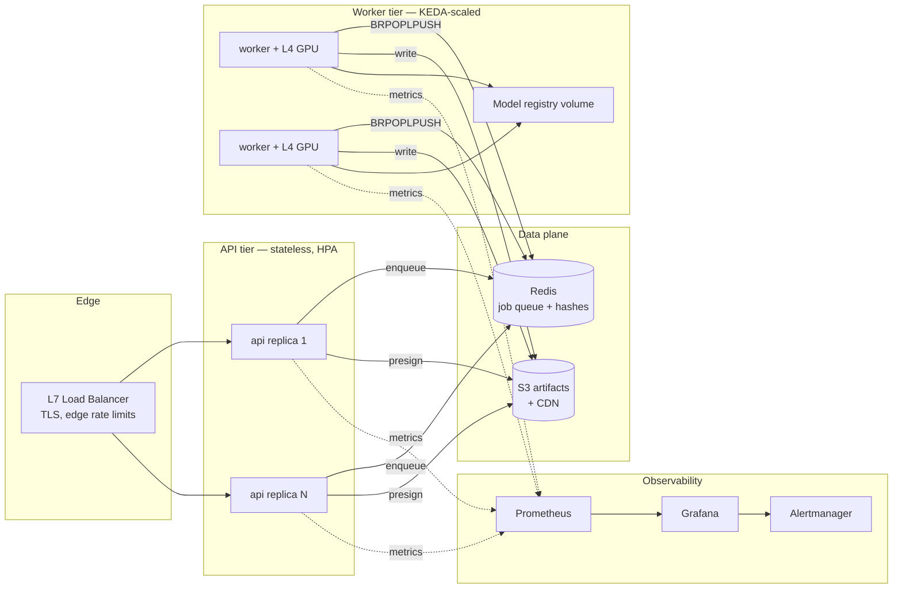

# System Architecture

> Status: current · Last audited: 2026-10-18 · Owner: @AdilShamim8

## 1. What this platform is

A multi-modal generation system with two planes sharing one codebase:

1. **The research plane** — VAE, GAN, autoregressive, and latent-diffusion
   implementations (`src/multimodal/models`, `training`, `sampling`,
   `evaluation`) faithful to the papers they cite.
2. **The serving plane** — a production system that turns those models into
   an API: admission control, queuing, GPU workers, artifact storage,
   safety gates, and observability (`src/multimodal/serving`).

The design rule that keeps both healthy: **the serving plane never reaches
into model internals** — it consumes pipelines through
`InferenceEngine`'s narrow interface. Research code can refactor freely
without breaking production contracts, and production can harden freely
without slowing research iteration.

## 2. Topology



## 3. Request lifecycle (the only path that matters)

```
POST /v1/generations
  → auth (constant-time API key)
  → token-bucket rate limit (per key)
  → moderation gate (blocklist + classifier hook)
  → schema validation (422 on bad geometry)
  → admission control (queue depth < max, else 503 + Retry-After)
  → LPUSH job id → 202 Accepted {job_id, status URL}

Worker loop (each replica):
  → BRPOPLPUSH queue → processing list      (reliable queue)
  → state QUEUED → RUNNING (journaled)
  → BatchScheduler groups by execution signature
  → InferenceEngine.execute(job)             (OOM → degrade → retry ≤ 2)
  → artifacts → S3 (checksummed, presigned)
  → state → SUCCEEDED + artifact keys
  → LREM processing list

GET /v1/generations/{id} → job hash → status, timings, presigned URLs
```

The `sync=true` short-circuit runs the same engine inline under a 30s
budget and *falls back to the queue* on overrun — never fails a job that
the queue could still serve.

## 4. Module map

| Module | Responsibility | Key invariants |
|---|---|---|
| `multimodal.serving.routes` | HTTP contract | Thin handlers; zero business logic |
| `multimodal.serving.queue` | Durable job queue | Reliable-queue pattern; crash recovery on startup |
| `multimodal.serving.jobs` | Job state machine | Transitions validated; journaled to `mm:job:{id}:events` |
| `multimodal.serving.engine` | Model execution | Lazy load; OOM degradation; deterministic seeds |
| `multimodal.serving.batching` | GPU utilisation | Signature grouping; latency-bounded flush |
| `multimodal.serving.artifacts` | Media persistence | Atomic writes; presigned resolution; path-traversal blocked |
| `multimodal.serving.moderation` | Safety | Runs pre-queue; pluggable classifier |
| `multimodal.models.*` | Research implementations | Import-isolated from serving |
| `multimodal.config` | Experiment configs | Strict coercion — typos fail at startup |

## 5. Cross-cutting decisions

* **Correlation ids** — one id follows a request through API → queue →
  worker → logs → job record. Non-negotiable for incident triage.
* **Stateless API, stateful queue** — API replicas scale on CPU traffic;
  the queue holds all in-flight state, so rolling deploys of the API tier
  are zero-downtime by construction.
* **Workers own GPU state** — one worker per GPU; KEDA scales replicas,
  never per-GPU concurrency (batch memory scales with geometry).
* **Config is code-reviewed** — YAML configs coerce into dataclasses with
  unknown keys rejected; an operator typo is a deploy-time error, not a
  silent misconfiguration discovered in metrics three days later.

## 6. Where it extends

* **Model swap** — drop a bundle (weights + manifest) in the registry and
  change `MM_T2I_MODEL`; no code changes.
* **New sampler** — implement and register; the config surface already
  accepts the name (registry pattern, `multimodal.registry`).
* **Multi-region** — the API tier is stateless; the queue and artifact
  store are the replication points (see scaling doc §6).

Related: [data-flow](data-flow.md) · [API design](api-design.md) ·
[scaling to 100M users](scaling-100m-users.md) · [failure modes](failure-modes.md)
